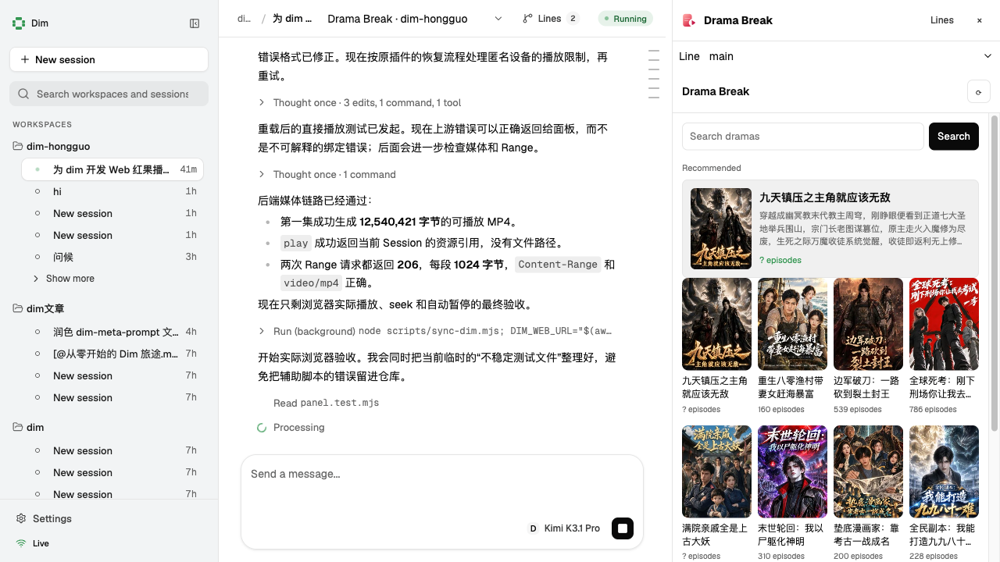
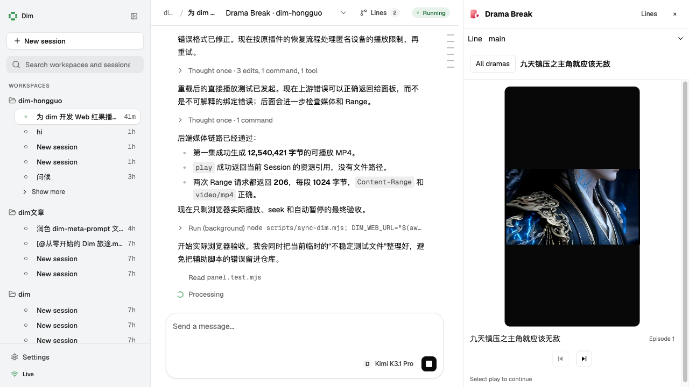

# dsh-hongguo / dim-hongguo

摸鱼短剧：一个基于 openhongguo 的短剧播放器。原 DSH 插件保留不变；`dim/manifest/` 是使用 Dim Web UI 扩展契约实现的独立插件。

## Dim Web 插件

要求 `dima 0.1.0-alpha.20` 或更高，以及宿主已启用 Node 插件运行时。Node.js 需要 >=20；`@arcships/rutis` 固定为 `0.19.3`，与 `~0.19.0` 的宿主 peer dependency 匹配，不要使用技能示例中旧宿主的 `0.17.1`。

```sh
npm install --prefix dim/manifest
# 在 Dim 中执行 plugin install /absolute/path/dim-hongguo/dim/manifest
# Node runtime 未安装时，按 Dim 的 Runtime 提示安装。
dima web
```

在已有的空闲会话中，从 **Extensions → Drama Break / 摸鱼短剧** 打开面板。新建会话须完成初始化并出现插件 Session 方法后才能挂载。





- [dim/manifest/dim-plugin.json](dim/manifest/dim-plugin.json)：面板声明、所需能力和四个插件 Session 方法。
- [dim/manifest/backend.js](dim/manifest/backend.js)：SDK、匿名设备档案、搜索、ffmpeg 媒体准备和按 Session 的 `uiResources.publishFile`。
- [ui/panel.js](ui/panel.js)：ShadowRoot `mount(root, context)`，无前端框架、无构建依赖。
- [ui/panel.css](ui/panel.css)：使用 `--dim-ui-*` 主题变量的响应式布局。

**不要直接编辑安装目录中的 `dim/manifest/ui/` 或 `dim/manifest/dim/`。** UI 源文件是 `ui/` 和根 `icon.svg`。后端编辑在 `dim/manifest/backend.js`。同步 UI、提交新快照并重载：

```sh
npm run sync:dim
# 在 Dim 中执行 plugin reload dim-hongguo
```

面板包含推荐/刷新、搜索、选集、上下集、原生倍速/全屏、自动连播、观看历史与续播、整个 Session 从工作状态变空闲时自动暂停。关闭或切换面板会停止视频；资源不会跨 Session 共享。历史存于当前浏览器的 localStorage，不跨浏览器或设备同步，也不进入模型上下文。

### 平台和资源限制

- Dim 插件后端执行于 **App Server 宿主**，视频文件与封面通过受鉴权、按 Session 授权的资源入口发送到浏览器；远端浏览器无需访问自己的 `localhost`。
- 支持加密的下载型 MP4：用 SDK 提供的内容密钥执行 ffmpeg 解密/重封装，不重编码。播放前需要下载整集，非即时流式解密。仅开放专门生成的文件，不提供任意 URL 代理或任意宿主文件读取。
- 宿主需要 `ffmpeg`（例如 macOS `brew install ffmpeg`）；封面使用 macOS `sips` 转换为 JPEG，因此当前后端媒体预处理面向 macOS，不应认为已支持 Linux/Windows。
- 源视频仍可能是 HEVC，`hvc1` 重封装不是转码；浏览器/系统必须支持该编码。转码、HLS/DASH 在线播放、全平台封面转换未纳入本版。
- 文件位于 Dim product home 的 `plugin-data/dim-hongguo/`；支持 `DIMCODE_HOME` 自定义。匿名设备档案使用 `0600`，内容密钥、上游签名 URL 和媒体路径不返回浏览器。进程 reload 后旧资源引用失效。
- 非官方 SDK、内容访问、解密与缓存仅供个人学习研究。请在 SDK 与内容服务条款及适用法律允许的范围内使用；内容版权归权利人所有。

以下原始 DSH 章节与截图描述的是 [`index.js`](index.js) / [`client.js`](client.js) 的实现，而非新 Dim 面板。

数据来自 [openhongguo](https://github.com/beilunyang/openhongguo)（第三方短剧平台的非官方 SDK，匿名设备、无需登录）。请仅用于个人学习与研究，内容版权归权利人所有。

## 截图

**剧集列表**：顶部推荐一部没看过的热门剧，下面每页 12 部，`换一批` 翻页；`观看历史` 点开才显示。


**播放器**：画面按视频比例自适应，画面内控制条（进度拖动、下一集、倍速、静音、全屏），选集按 50 集分段。


**等待提示**：Agent 运行时在输入框上方出现，点剧名直接开播，`更多…` 打开播放器。


## 功能

| 位置 | 内容 |
|---|---|
| 右侧边栏 | `摸鱼短剧` 标签页：推荐卡片 + 剧集列表（带封面、可搜索）→ 分集 → 播放器 |
| 剧集列表 | 按面板宽度自适应：每行 6 / 4 / 3 / 2 部，每页 12 部，`换一批` 翻到下一页 |
| 播放历史 | 记住每部剧看到第几集、第几秒；`观看历史` 按钮点开后一键续播，可单条移除 |
| 播放器 | 画面内控制条、倍速（1–2×）、全屏、自动连播下一集、续播提示 |
| 左侧栏底部 | `短剧` 按钮，一键打开播放器 |
| 输入框上方 | Agent 运行时出现浮框：3 部剧可直接点开，`更多…` 打开播放器；当前页面已显示播放器时不出现 |
| 任务完成 | Agent 从运行变为空闲时自动暂停正在播放的短剧，并在画面上提示 |
| 侧边栏引导页 | 一个 `摸鱼短剧` 入口卡片 |

## 结构

- **Host 半（`index.js`）**：加载 openhongguo SDK、维护匿名设备档案，提供同源路由 `/api/hongguo/{feed,series,play,media,stream,config,running}`、`/api/hongguo/cover` 与 `/api/hongguo/vendor`。启动时预先拉取剧集列表。CDN 只提供 HEIC 封面，Host 用 macOS 的 `sips` 转成 JPEG 并缓存。
- **Client 半（`client.js`）**：注册侧边栏标签页类型 `hongguo`、侧栏底部按钮，以及 `conversation.input.dock` 里的等待提示。

## 播放与解密

视频是 CENC（cenc-aes-ctr）加密的 HEVC，浏览器无法直接解码。Host 用 SDK 解析出的内容密钥调用本机 `ffmpeg` 解密并重封装为普通 MP4（`-c copy`，不重编码），缓存在插件数据目录 `media/`（保留最近 40 集）。页面只拿到同源 `/api/hongguo/media` 地址，密钥不出 Host。

需要安装 ffmpeg：`brew install ffmpeg`。

## 配置

`cordis.patch.yml` 中 `hongguo` 行的 `config`：

| 字段 | 默认 | 说明 |
|---|---|---|
| `autoPrompt` | `true` | Agent 运行时是否显示提示 |
| `panelWidth` | `480` | 播放器标签页的默认宽度（px） |
| `profilePath` | 插件数据目录 | 匿名设备档案文件；删除即更换设备 |
| `searchTerms` | `总裁/重生/逆袭` | 推荐不足时补充列表用的搜索词 |
